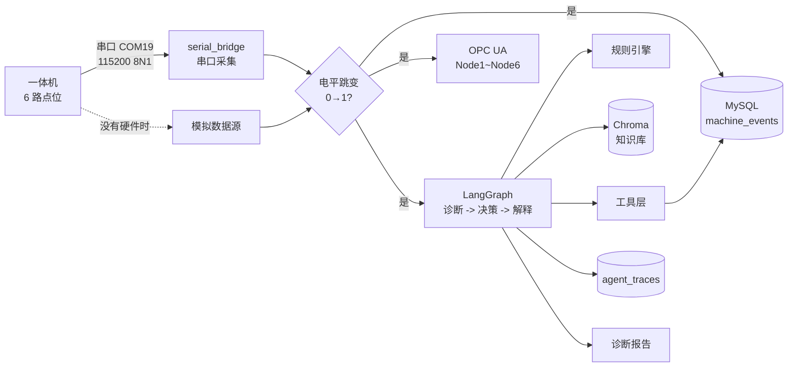
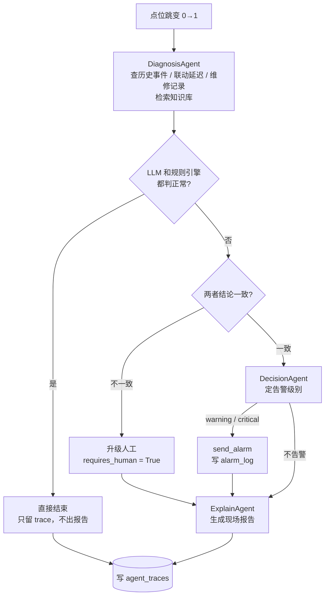

# 鲍鱼清洗去壳一体机 数字孪生与多智能体诊断

给实验室那台鲍鱼清洗去壳一体机（STM32F407 主控，机器编号 `F407_Line1`）做的状态监控和故障诊断程序。

设备上能读出来的就 6 个开关量：接近开关、摆臂大电机、真空发生器、夹爪、红外漫反射、颜色传感器。以前只在触摸屏上看当前状态，机器慢了、掉件了，基本靠师傅的经验判断是气路问题还是夹爪问题。我的想法是把这 6 路信号接出来，一半用来做数字孪生（实时状态镜像 + 历史事件留档），一半交给几个 Agent 去做诊断，把"节拍变慢"这种模糊的说法落到具体原因上。

## 做了什么

- 串口实时采集 6 路开关量，跳变时落库，同时把状态写到 OPC UA 节点，上位机可以直接订阅
- 每次跳变触发一轮诊断，规则引擎算节拍和联动延迟有没有超阈值，LLM 结合维修记录、手册判断可能的原因
- 规则和 LLM 结论不一致时不自动告警，标出来交给人看
- 推理过程全部存到 `agent_traces`，可以回放，也拿来做评测集

## 系统结构



主循环在 `main.py` 里，采集和诊断是分开的：诊断用 `asyncio.create_task` 扔到后台，不阻塞采集，不然一条 LLM 请求几秒钟，数据就丢了。

## 数字孪生

这部分解决的是"设备现在什么状态、之前发生过什么"，Agent 的判断都建立在这上面。

```
物理侧                        数字孪生侧
─────────────              ────────────────────────────
接近开关  ┐                 ┌ Node1  实时状态（OPC UA）
摆臂大电机 ├─ 串口 JSON ─→  ├ Node2
真空发生器 │  115200 8N1    ├ Node3
夹爪      │                ├ ...
红外漫反射 │                └ Node6
颜色传感器 ┘
                             └ machine_events  历史事件（毫秒精度）
                                  └ agent_traces  决策快照
```

| 层级 | 存在哪 | 作用 |
| --- | --- | --- |
| 状态镜像 | OPC UA，`opc.tcp://0.0.0.0:4840`，命名空间 `http://machine.local` | 6 个节点实时反映物理点位，能被 SCADA 订阅 |
| 历史事件 | MySQL `machine_events` | 每次跳变记下旧值、新值、时间、班次、计件 |
| 决策快照 | MySQL `agent_traces` | 事件、诊断、决策、解释四段，配合人工标注复盘 |

目前只做到开关量这一级，够判断节拍类和联动类故障。真空度、电机电流、转速这些连续量还没接，原因写在下面的"还没做的"里。

点位含义和阈值来自 `knowledge/设备参数.txt`，改设备参数以后要重跑一次 `seed_knowledge.py`，不然检索到的还是旧文本。

## 三个 Agent

用 LangGraph 串起来，诊断、决策、解释依次执行，状态在节点之间传。

| Agent | 输入 | 干什么 | 输出 |
| --- | --- | --- | --- |
| DiagnosisAgent | 事件 + 知识库检索结果 | 查历史事件、联动延迟、维修记录，判正常/疑似异常/异常 | 结论、证据、置信度、可能原因 |
| DecisionAgent | 诊断结果 | 按规则定告警级别，需要时调 `send_alarm` | 是否告警、级别、理由 |
| ExplainAgent | 决策结果 | 写成现场人员看得懂的话 | 中文报告 |

两个边界情况单独处理了：

- LLM 说异常但规则引擎没触发，或者反过来，不自动告警，`requires_human=True` 交给人判断。误报的代价比漏报高，宁可多给人看一遍。
- 任何一个 Agent 抛异常，图直接走到 `END`，记录错误后返回，不影响主循环继续采集。

实际的判断流程这样走（和 `graph.py` 里的路由一致）：



"都判正常"那一支是直接结束的，不走决策和解释，所以正常工况下没有报告输出，只有 trace 记录 —— 这也是刚启动时看不到报告的原因之一。

Agent 能调的工具放在 `tools.py`：

- `query_recent_events` 查某点位最近 N 分钟的事件
- `get_sensor_correlation` 算两个点位的响应延迟
- `get_production_stats` 班次产量
- `query_maintenance_log` 查维修记录
- `send_alarm` 写告警到 `alarm_log`

## 目录

```
industrial_agent/
├── main.py               主循环 / sim 模拟模式 / eval 评测模式
├── graph.py              LangGraph 状态图和路由
├── agents/
│   ├── diagnosis.py
│   ├── decision.py
│   └── explain.py
├── rule_engine.py        夹爪节拍、真空到夹爪延迟的判定
├── rag_knowledge.py      Chroma 封装
├── tools.py              工具实现和 schema
├── llm_client.py         LLM 客户端，含 ReAct 循环
├── config.py             配置，全部从环境变量读
├── init_db.py            建表
├── simulate_data.py      造 30 天模拟数据
├── serial_bridge.py      串口采集
├── seed_knowledge.py     知识库入向量库
├── seed_eval.py          生成评测集
├── evaluation.py         评测和 trace 入库
├── eval_dataset.json     50 条评测用例
├── knowledge/            工艺标准、常见故障、维修手册、设备参数
├── tests/                规则引擎的单元测试
├── requirements.txt
├── requirements-dev.txt
└── SOP.md                环境搭建和测试流程
```

## 跑起来

需要 Python 3.11 以上、MySQL 8.0、一个 DeepSeek 的 Key。没有 Key 也可以用本地的 Ollama。

```bash
git clone https://github.com/roza2006/industrial_agent.git
cd industrial_agent

python -m venv .venv
.venv\Scripts\activate
pip install -r requirements.txt
```

配置。复制一份模板，把 Key 和数据库密码填进去：

```bash
copy .env.example .env
```

```ini
LLM_PROVIDER=deepseek
DEEPSEEK_API_KEY=sk-your-deepseek-api-key
MYSQL_HOST=127.0.0.1
MYSQL_PORT=3307
MYSQL_USER=root
MYSQL_PASSWORD=your-mysql-password
MYSQL_DATABASE=machine_data
```

也可以直接用环境变量，优先级比 `.env` 高。仓库里没有提交任何密钥，`.env` 和 `config_local.py` 都在 `.gitignore` 里。

初始化只跑一次，顺序别乱：

```bash
python init_db.py          建表
python simulate_data.py    灌 30 天模拟数据
python seed_knowledge.py   知识库进向量库，第一次会下载 embedding 模型
python seed_eval.py        生成评测集
```

运行：

| 命令 | 数据来源 | 用途 |
| --- | --- | --- |
| `python main.py sim` | 内置模拟器 | 没有设备时调 Agent |
| `python main.py` | 串口 | 上机运行 |
| `python main.py eval` | `eval_dataset.json` | 跑评测 |

`main.py sim` 跑起来大概是这样：

```
✅ MySQL 已连接
✅ OPC UA 已启动: opc.tcp://0.0.0.0:4840
✅ 多Agent图已构建 (LLM: deepseek/deepseek-flash)
🎮 使用模拟数据源（无串口模式）
🚀 系统就绪，等待数据...
```

## 参数和阈值

点位映射：

| 通道 | 点位 | 工艺含义 | 计件 | 正常范围 |
| --- | --- | --- | --- | --- |
| n1 | 接近开关 | 鲍鱼到位 | 否 | 随节拍触发 |
| n2 | 摆臂大电机 | 送料、翻转 | 否 | 1500 rpm，2.5~4.0 A |
| n3 | 真空发生器 | 吸附鲍鱼 | 否 | 响应 < 0.8 s，真空度 ≥ -60 kPa |
| n4 | 夹爪 | 夹持、去壳 | 是 | 节拍 2.0~3.0 s |
| n5 | 红外漫反射 | 有无工件 | 否 | 响应 < 100 ms |
| n6 | 颜色传感器 | 色泽识别 | 否 | 响应 < 200 ms |

工艺标准（跟知识库一致）：

| 项 | 标准 | 判定 |
| --- | --- | --- |
| 节拍 | 2.5 s/件，允许 ±0.3 s | 超过 3.5 s 算异常 |
| 真空吸附 | 0.8 s | 维护后应小于 1.0 s |
| 真空度 | ≥ -60 kPa | 不足容易掉件 |
| 泄漏 | < 5 kPa/min | 超了查接头和滤芯 |
| 连续超差 | 连续 3 件 | 停机检查 |

阈值在 `rule_engine.py`：

```python
"gripper_max_cycle": 3.5,   # 夹爪平均节拍上限，秒
"vacuum_max_delay": 1.5,    # 真空到夹爪平均延迟上限，秒
"min_samples": 5,           # 判定所需最少样本
```

这三个数必须按自己的机器改。实验室这台空转的时候节拍大概 2.6 s，带负载会到 2.8 s 左右，所以 3.5 是留了余量的。放太松会一直判正常，太紧每条都告警，我在 `sim` 模式下跑了几轮统计才定的。

## 数据库

| 表 | 什么时候写 | 主要字段 |
| --- | --- | --- |
| `machine_events` | 每次跳变 | `sensor_name`、`old_value`、`new_value`、`product_count`、`shift` |
| `alarm_log` | Agent 调 `send_alarm` | `level`、`message` |
| `maintenance_log` | 补录维修记录 | `sensor_name`、`maint_time`、`description` |
| `agent_traces` | 每次推理结束 | 四段 JSON、`human_feedback` |

平时查得比较多的几条：

```sql
-- 夹爪今天的节拍
SELECT event_time,
       TIMESTAMPDIFF(MICROSECOND,
         LAG(event_time) OVER (ORDER BY event_time), event_time)/1e6 AS cycle_sec
FROM machine_events
WHERE sensor_name = '夹爪' AND new_value = 1 AND DATE(event_time) = CURDATE();

-- 最近 20 条推理
SELECT trace_time, diagnosis_json, decision_json
FROM agent_traces ORDER BY trace_time DESC LIMIT 20;

-- 今天各告警级别的数量
SELECT level, COUNT(*) FROM alarm_log
WHERE DATE(alarm_time) = CURDATE() GROUP BY level;
```

`human_feedback` 是留着自己标数据的，标错了的 trace 前面加个标记，以后拿来做 few-shot。

## 和机器对接

串口按行读，一行一个 JSON，UTF-8，`\n` 结尾：

```json
{"n1":0,"n2":0,"n3":1,"n4":0,"n5":0,"n6":0}
```

值只有 0 和 1。不以 `{` 开头、`}` 结尾的行会丢掉，所以中间混调试输出没关系。上报间隔我试过 50 ms 和 100 ms，都能跟上，太密了串口那边反而容易丢。

STM32 侧就是一条 printf：

```c
printf("{\"n1\":%d,\"n2\":%d,\"n3\":%d,\"n4\":%d,\"n5\":%d,\"n6\":%d}\r\n",
       s1, s2, s3, s4, s5, s6);
```

OPC UA 的节点从 `Node1` 到 `Node6`，上位机这样读：

```python
from asyncua import Client
async with Client(url="opc.tcp://127.0.0.1:4840") as c:
    node = await c.nodes.objects.get_child(["0:Objects", "2:Node4"])   # 夹爪
    print(await node.read_value())
```

节点现在是可以写的（`main.py` 里调了 `set_writable()`），如果只想当只读镜像，把那行去掉。

上机前我自己会过一遍这几项：

- `MACHINE_ID` 改成实际编号，多台机器共库的时候别重名
- 阈值按这台机器的节拍标定过
- 事件触发加了节流，不然 LLM 会被打满（每条事件至少三次请求）
- MySQL 有备份，`agent_traces` 有清理策略，不然表涨得很快
- 4840 端口在防火墙放行
- `send_alarm` 接到了实际的告警渠道
- 水路、气源、夹爪的联锁还是由 PLC 负责，不经过这套程序

## 踩过的坑

| 现象 | 原因 | 处理 |
| --- | --- | --- |
| `401 Unauthorized` | Key 没加载 | 看 `.env` 是不是在根目录，或者环境变量有没有生效 |
| `Can't connect to MySQL server` | MySQL 没起 / 端口不对 | `Get-Service MySQL80`，`netstat -ano` 看 3307 |
| `Access denied for user 'root'` | 密码不对 | 带特殊字符的密码要加引号 |
| `could not open port COM19` | 端口被串口助手占着 | 先关掉串口助手 |
| OPC UA `Address already in use` | 4840 被别的程序占了 | 换个端口，或者停掉冲突的服务 |
| `seed_knowledge.py` 卡住 | 下 embedding 模型超时 | 设 `$env:HF_ENDPOINT="https://hf-mirror.com"` |
| 报告全是"正常" | 样本不够或者阈值太松 | 多跑一会，或者回头看 `rule_engine.py` |
| 中文乱码 | 控制台编码 | `chcp 65001` 或 `$env:PYTHONUTF8=1` |
| `ModuleNotFoundError: config_local` | 没有本地覆盖文件，正常 | 不用管，`config.py` 里已经捕获了 |

更细的部署和排错步骤记在 `SOP.md` 里。

## 还没做的

- 连续量还没接（真空度、电机电流、转速）。现在的串口协议只有开关量，要扩成 `{"n1":0,...,"vac":-63.2,"cur":3.1,"rpm":1480}`，判断方式也得从跳变触发改成滑动窗口
- 想把状态和节拍画成曲线，现在只能看终端输出和 SQL
- 事件节流还没做，现在是每条都触发诊断
- 只有规则引擎有单元测试，Agent 那条链路要 mock 掉 LLM 才好测，一直没腾出时间
- 多台机器并联运行没验证过，`MACHINE_ID` 是留了字段的

## 其他

License 用的 MIT。

诊断结果只能作参考，水路、气源、机械夹持这些安全相关的联锁不能依赖这套程序，必须保留硬件急停。
